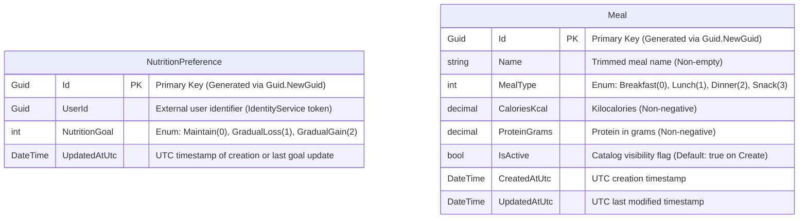
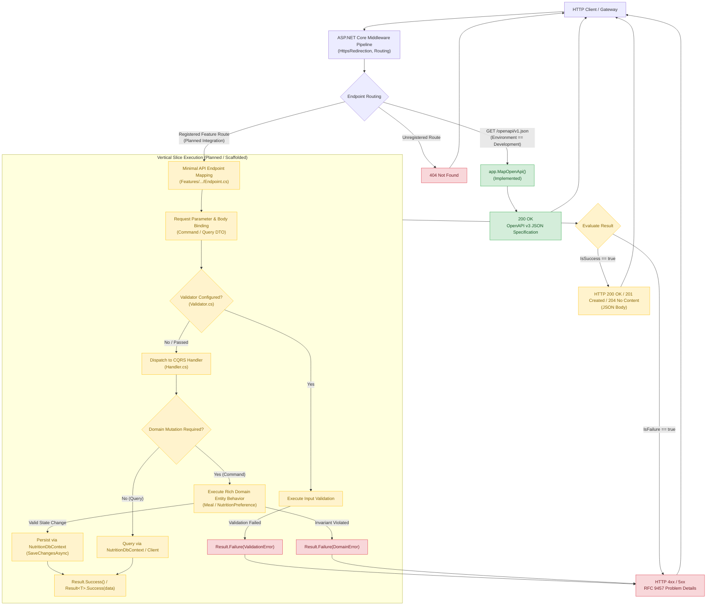

# NutritionService

The **NutritionService** is an independent microservice within the **FitnessApp-team2** distributed system. It is responsible for managing user nutrition goals, calculating daily calorie targets in coordination with user fitness profiles, maintaining the curated meal catalog, and delivering deterministic meal recommendations.

---

## 1. Overview

`NutritionService` operates as an autonomous microservice designed around domain boundaries and bounded contexts:

- **Core Responsibilities:**
  - Managing user-specific nutrition goals and preferences.
  - Computing daily calorie targets by integrating with external fitness profile metrics.
  - Maintaining a curated, macro-tracked meal catalog (admin operations, browsing, and detail queries).
  - Providing deterministic meal recommendations aligned with calculated calorie targets.
- **Architecture & Technologies:** Built on **.NET 10** and **ASP.NET Core Minimal APIs**, organized via **Vertical Slice Architecture (VSA)** and **CQRS**, with persistence modeled via **Entity Framework Core**.
- **Database Ownership & Service Boundaries:** NutritionService strictly owns its database and persistence schema. Cross-service communication (such as obtaining Total Daily Energy Expenditure from `FitnessProfileService`) occurs exclusively over synchronous, typed HTTP client calls. Direct cross-database access, shared tables, and shared class libraries are prohibited.
- **Error-Handling Approach:** Business operations return structured `Result` and `Result<T>` objects with typed `Error` records. At the HTTP boundary, failures are translated into standardized **RFC 9457 Problem Details** responses rather than bubbling unhandled exceptions.

---

## 2. Architecture

`NutritionService` follows modern architectural patterns supported directly by its codebase:

- **Vertical Slice Architecture (VSA):** Use cases are located under `Features/` and organized by business capability rather than technical tiers. Each slice contains the specific endpoint, command/query, handler, validator, and response types required for that capability.
- **CQRS (Command Query Responsibility Segregation):** Feature slices explicitly separate state-mutating operations (`Command`) from read-only data operations (`Query`).
- **Rich Domain Layer:** Entities (`Meal`, `NutritionPreference`) in `Domain/Entities/` enforce business invariants through private constructors, private property setters, static factory methods (`Create`), and domain behavior methods (`Update`, `ChangeGoal`, `Deactivate`). Entities manage UTC audit timestamps directly.
- **Result Pattern:** Located in `Common/`, `Result`, `Result<T>`, and `Error` provide functional result packaging across handler and domain boundaries, eliminating the need to use exceptions for control flow.
- **Infrastructure & Persistence:** Encapsulated inside the service boundary under `Persistence/` (`NutritionDbContext`, entity configurations) and `Infrastructure/` (external HTTP clients).

> **Current Implementation Status:**
> - **Fully Implemented:** Domain Entities (`Meal`, `NutritionPreference`), Domain Enums (`NutritionGoal`, `MealType`), and the Result pattern types (`Result`, `Result<T>`, `Error`).
> - **Scaffolded (Clean Class/Interface Skeletons):** Feature slices (Endpoints, Commands, Queries, Handlers, Validators), `NutritionDbContext` entity configurations, DI extension methods, and external HTTP client contracts.

---

## 3. Project Structure

```text
NutritionService/
│
├── Common/                                   # Service-wide cross-cutting primitives
│   ├── Error.cs                              # Error record with code and description
│   ├── Result.cs                             # Non-generic Result type for command operations
│   └── ResultT.cs                            # Generic Result<T> for query outcomes
│
├── Domain/                                   # Enterprise business rules and core domain
│   ├── Entities/                             # Rich domain entities with encapsulated state
│   │   ├── Meal.cs                           # Meal entity: macros, active status, invariants
│   │   └── NutritionPreference.cs            # User goal preference and audit tracking
│   └── Enums/                                # Strongly typed domain enumerations
│       ├── MealType.cs                       # Meal classification (Breakfast, Lunch, Dinner, Snack)
│       └── NutritionGoal.cs                  # Goal types (Maintain, GradualLoss, GradualGain)
│
├── Features/                                 # Vertical feature slices (CQRS use cases)
│   ├── CalorieTargets/                       # Daily calorie target calculations
│   │   └── GetDailyCalorieTarget/            # Endpoint, Query, Handler, Response
│   ├── MealRecommendations/                  # Deterministic meal recommendations
│   │   └── GetMealRecommendations/           # Endpoint, Query, Handler, Response
│   ├── Meals/                                # Meal catalog management and discovery
│   │   ├── BrowseMeals/                      # Endpoint, Query, Handler, Response
│   │   ├── CreateMeal/                       # Endpoint, Command, Handler, Validator
│   │   ├── DeactivateMeal/                   # Endpoint, Command, Handler
│   │   ├── GetMealDetails/                   # Endpoint, Query, Handler, Response
│   │   └── UpdateMeal/                       # Endpoint, Command, Handler, Validator
│   └── NutritionGoals/                       # User nutrition goal management
│       ├── GetMyNutritionPreference/         # Endpoint, Query, Handler, Response
│       └── SetNutritionGoal/                 # Endpoint, Command, Handler, Validator
│
├── Infrastructure/                           # External service clients & integrations
│   └── FitnessProfile/                       # Synchronous HTTP integration with FitnessProfileService
│       ├── Contracts/                        # External DTO contracts (e.g., TdeeResponse)
│       ├── FitnessProfileClient.cs           # Typed HTTP client implementation
│       ├── IFitnessProfileClient.cs          # Client interface definition
│       └── Options/                          # Client configuration options
│
├── Persistence/                              # Database access layer
│   ├── Configurations/                       # EF Core entity type configurations (IEntityTypeConfiguration)
│   │   ├── MealConfiguration.cs              # Meal entity Fluent API configuration
│   │   └── NutritionPreferenceConfiguration.cs # NutritionPreference Fluent API configuration
│   └── NutritionDbContext.cs                 # EF Core DbContext containing Meals and Preferences
│
├── Extensions/                               # Host and pipeline registration helpers
│   ├── EndpointRouteBuilderExtensions.cs      # Minimal API route mapping helpers
│   ├── ProblemDetailsExtensions.cs            # RFC 9457 ProblemDetails error mapping
│   └── ServiceCollectionExtensions.cs         # Dependency injection registrations
│
├── Properties/
│   └── launchSettings.json                   # Local development launch profiles (HTTP, HTTPS, Docker)
├── appsettings.json                          # Base logging and host configuration
├── appsettings.Development.json              # Development environment logging overrides
├── Dockerfile                                # Multi-stage container build definition
├── NutritionService.csproj                   # Project file and dependencies
├── NutritionService.http                     # HTTP request scratchpad
└── Program.cs                                # Application entry point and minimal HTTP pipeline
```

---

## 4. Database / Domain Model Diagram

The following diagram represents the **Current Domain Model** derived from the entity implementations and `NutritionDbContext` definitions.



> [!NOTE]
> - **Domain Model Status:** This diagram reflects the current Domain Model and configured `DbSet<T>` properties. It does **not** represent a verified physical database schema, as concrete database provider registration, connection strings, and EF Core migrations are pending infrastructure setup.
> - **Aggregate Independence:** `NutritionPreference` and `Meal` are independent aggregates within this bounded context; there are no foreign keys or navigation properties between them. `UserId` is an external token identifier referencing `IdentityService`, not an in-database foreign key.

---

## 5. Complete HTTP Request Flow

The diagram below illustrates the end-to-end HTTP request lifecycle across `NutritionService`, highlighting the active baseline pipeline alongside the planned vertical slice execution flow:



---

## 6. Error Handling & Problem Details

> [!IMPORTANT]
> **Adopted Design Decision – Planned, Not Yet Implemented.**
> Problem Details (RFC 9457) is the adopted standard for all HTTP error responses across the service. The extension skeleton exists in `Extensions/ProblemDetailsExtensions.cs`, but its middleware and endpoint filter integration are not yet wired up in `Program.cs`.

### What Problem Details Is & Why It Is Used

**RFC 9457** (superseding RFC 7807) defines a standardized JSON schema for HTTP API error details. It ensures that client applications receive predictable, structured, and machine-readable error responses across all microservices, while preventing sensitive stack traces from leaking to consumers.

### Error Classification & HTTP Status Code Mapping

When implemented, application and domain errors will map to standard HTTP status codes:

| Error Category | Source | Description | HTTP Status |
|---|---|---|---|
| **Validation Errors** | Input validators (`Validator.cs`) | Malformed input, negative values, empty strings | `400 Bad Request` |
| **Domain Errors** | Rich Domain Entities | Invariant violations (e.g., updating a deactivated meal) | `400 Bad Request` / `422 Unprocessable Entity` |
| **Not Found Errors** | Query / Command Handlers | Requested meal or preference identifier does not exist | `404 Not Found` |
| **Conflict Errors** | Entity state / Persistence | Concurrency conflicts or duplicate state attempts | `409 Conflict` |
| **Internal / Unhandled** | Runtime / Infrastructure | Unexpected exceptions or external service failures | `500 Internal Server Error` |

### Integration with the Result Pattern

Feature handlers execute business logic and return `Result` or `Result<T>` containing an `Error` record on failure. The HTTP endpoint layer evaluates the result:
- On success (`IsSuccess == true`), the handler outcome is returned with an appropriate HTTP 2xx status.
- On failure (`IsFailure == true`), a Problem Details response is generated using the error code and description:

```json
{
  "type": "https://tools.ietf.org/html/rfc9457",
  "title": "Validation Error",
  "status": 400,
  "detail": "One or more validation errors occurred.",
  "instance": "/meals",
  "errors": {
    "CaloriesKcal": [
      "Calories must not be negative."
    ],
    "ProteinGrams": [
      "Protein grams must not be negative."
    ]
  }
}
```

---

## 7. Technologies

| Component | Technology | Version | Purpose |
|---|---|---|---|
| **Runtime & SDK** | .NET | `10.0` (`net10.0`) | Primary application runtime |
| **Web Framework** | ASP.NET Core Minimal APIs | Built-in | High-performance, lightweight HTTP pipeline |
| **Persistence / ORM** | Microsoft.EntityFrameworkCore | `10.0.0` | Object-Relational Mapping abstractions |
| **API Specification** | Microsoft.AspNetCore.OpenApi | `10.0.11` | OpenAPI v3 document generation |
| **Containerization** | Docker | Linux | Multi-stage production container build |
| **IDE Tooling** | Microsoft.VisualStudio.Azure.Containers.Tools.Targets | `1.23.0` | Visual Studio container tooling integration |

---

## 8. Getting Started

### Prerequisites

- [.NET 10.0 SDK](https://dotnet.microsoft.com/)
- [Docker](https://www.docker.com/) (optional, for container execution)

### Running Locally with .NET CLI

1. Open a terminal in the service directory:
   ```bash
   cd NutritionService
   ```

2. Restore NuGet packages:
   ```bash
   dotnet restore
   ```

3. Build the project:
   ```bash
   dotnet build --no-restore
   ```

4. Run using the HTTP launch profile:
   ```bash
   dotnet run --launch-profile "http"
   ```
   *Or run using the HTTPS profile:*
   ```bash
   dotnet run --launch-profile "https"
   ```

Local listening ports (configured in `Properties/launchSettings.json`):
- **HTTP:** `http://localhost:5041`
- **HTTPS:** `https://localhost:7293`
- **OpenAPI Document (Development):** `http://localhost:5041/openapi/v1.json`

### Running via Docker

> **Important:** The Docker build context must be the **solution root directory** (`FitnessApp-team2/`) because the `Dockerfile` resolves project references relative to the root.

From the **solution root directory**:

```bash
# 1. Build the Docker image
docker build -t nutritionservice:local -f NutritionService/Dockerfile .

# 2. Run the container binding HTTP port 8080
docker run -d -p 8080:8080 -e ASPNETCORE_ENVIRONMENT=Development --name nutrition-svc nutritionservice:local
```

Access the running container at:
- **HTTP:** `http://localhost:8080`
- **OpenAPI:** `http://localhost:8080/openapi/v1.json`

*(Note: Container HTTPS port 8081 requires mounting an ASP.NET Core developer certificate volume).*

---

## 9. Configuration

The service leverages standard ASP.NET Core configuration providers:

### Application Settings (`appsettings.json`)

```json
{
  "Logging": {
    "LogLevel": {
      "Default": "Information",
      "Microsoft.AspNetCore": "Warning"
    }
  },
  "AllowedHosts": "*"
}
```

### Environment Variables & Launch Settings

| Key | Context | Default / Configured Value |
|---|---|---|
| `ASPNETCORE_ENVIRONMENT` | All | `Development` |
| `applicationUrl` | Local Development | `http://localhost:5041` (HTTP) / `https://localhost:7293` (HTTPS) |
| `ASPNETCORE_HTTP_PORTS` | Container (Dockerfile) | `8080` |
| `ASPNETCORE_HTTPS_PORTS` | Container (Dockerfile) | `8081` |
| `UserSecretsId` | Local Development | `ea9eefcc-22ad-44f2-a7c5-5119c6b8c828` |

> **Security Rule:** Never store secrets (database connection strings, API tokens) in source-controlled configuration files. Use .NET User Secrets during local development and secure environment variables in deployment environments.

---

## 10. API Endpoints

### Implemented & Active Endpoints

Currently registered in `Program.cs`:

| HTTP Method | Route | Description | Status |
|---|---|---|---|
| `GET` | `/openapi/v1.json` | OpenAPI v3 document (Development environment only) | **Active** |

### Scaffolded Feature Slices (Pending Route Registration)

Feature endpoint definitions exist as class skeletons in their respective slices and await pipeline registration:

| Feature Slice Location | Target Operation | Status |
|---|---|---|
| `Features/NutritionGoals/SetNutritionGoal/` | Set or update user nutrition preference | Scaffolded |
| `Features/NutritionGoals/GetMyNutritionPreference/` | Retrieve authenticated user's current goal preference | Scaffolded |
| `Features/CalorieTargets/GetDailyCalorieTarget/` | Calculate daily calorie target via TDEE integration | Scaffolded |
| `Features/Meals/BrowseMeals/` | Browse active catalog meals | Scaffolded |
| `Features/Meals/GetMealDetails/` | Retrieve macro details for a specific meal | Scaffolded |
| `Features/Meals/CreateMeal/` | Admin endpoint to create a catalog meal | Scaffolded |
| `Features/Meals/UpdateMeal/` | Admin endpoint to modify meal macros and details | Scaffolded |
| `Features/Meals/DeactivateMeal/` | Admin endpoint to deactivate a meal (preserves identifier) | Scaffolded |
| `Features/MealRecommendations/GetMealRecommendations/` | Query deterministic meal recommendations | Scaffolded |

---

## 11. Development Notes

1. **Identifier Strategy:**
   - NutritionService-owned entities (`Meal.Id`, `NutritionPreference.Id`) use standard `Guid` identifiers generated on creation.
   - User identity (`UserId`) originates from `IdentityService` JWT claims and is maintained as `Guid`.
   - Snowflake ID generation was evaluated; as no shared or tested generator exists in the solution, `Guid` is maintained pending any team-wide architectural decision.
2. **Domain Invariant Enforcement:**
   - `Meal`: Rejects empty names, invalid `MealType` values, and negative `CaloriesKcal` or `ProteinGrams`. Deactivated meals strictly reject updates to prevent accidental modifications to archived items.
   - `NutritionPreference`: Rejects `Guid.Empty` for `UserId`, validates `NutritionGoal` against defined enum values, and updates `UpdatedAtUtc` on any goal change.
3. **Database Provider & Connection (Open Decision):**
   - The concrete database provider (PostgreSQL, SQL Server, etc.) and connection strings are not yet configured. `NutritionDbContext` is not yet registered in DI in `Program.cs`.
4. **External Service Integration:**
   - `NutritionService` integrates with `FitnessProfileService` strictly through typed synchronous HTTP (`IFitnessProfileClient`). The specific endpoint URL, route schema, and internal authentication mechanism will be finalized during client implementation.
